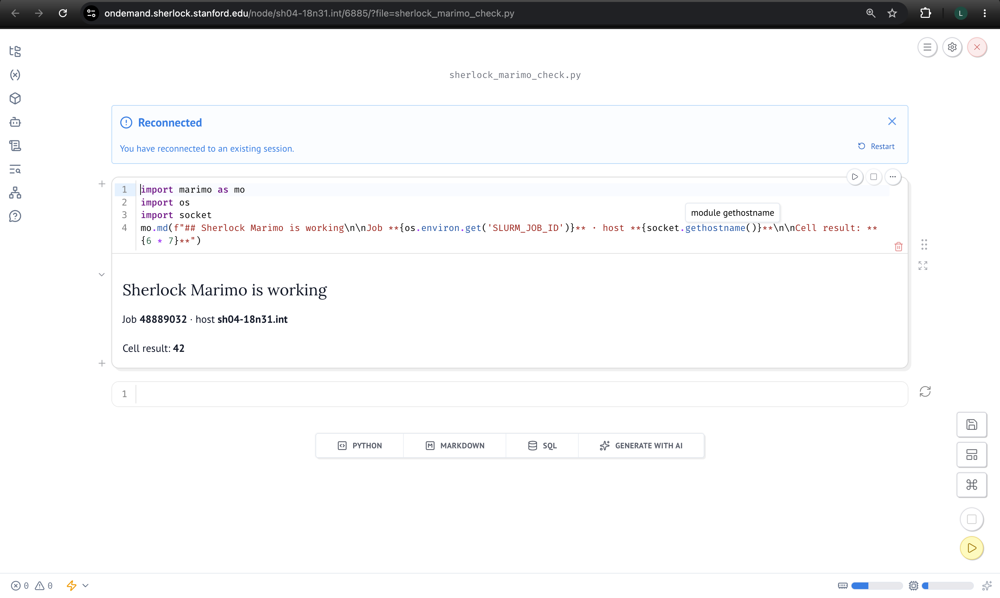
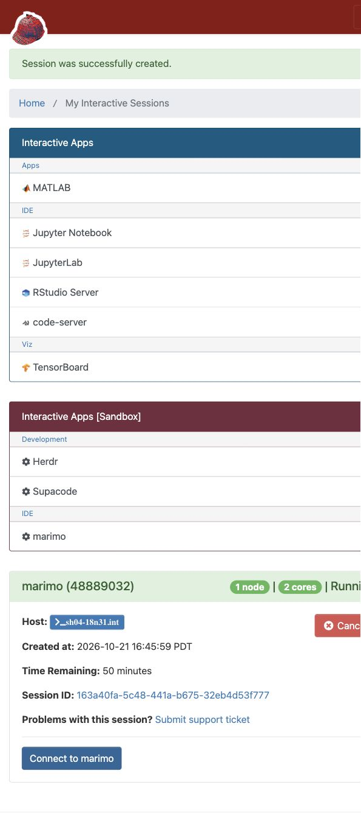

# marimo on Sherlock

This Open OnDemand app launches marimo's editable notebook home page in a Slurm
allocation, much like JupyterLab. Select a workspace, partition, CPU cores,
memory, and runtime; click **Launch**, then **Connect to marimo** when ready.
Open an existing marimo `.py` notebook or create one in its file browser.
The workspace is the initial browser directory, not a filesystem sandbox.

## Live Sherlock verification

Captured from the real Sherlock OnDemand session on **2026-10-21**. The notebook
ran on compute node `sh04-18n31.int` in Slurm job **48889032**, returned **42**,
and reconnected after saving and reloading. The browser used OnDemand's
authenticated `/node/sh04-18n31.int/6885/` proxy.



<details>
<summary>OnDemand session and sandbox app list</summary>

The matching session appears in OnDemand with a **Connect to marimo** button.
Herdr, Supacode, and marimo are all listed under **Interactive Apps [Sandbox]**.



</details>

These screenshots record a completed live check; the pictured allocation is
temporary. Start a new session through OnDemand when it expires.

## Install once

Sherlock's module catalog did not include marimo when checked on 2026-10-21.
It provided `devel`, `python/3.12.1`, and `uv/0.10.8`. Create a persistent Python
environment inside a compute allocation; the app never installs dependencies
at launch. This integration was tested with marimo **0.25.2**.

```bash
# On Sherlock; choose a partition you can use.
sdev -p russpold -c 2 --mem=4G -t 00:30:00
module load devel python/3.12.1 uv/0.10.8
# Keep packages in persistent personal group storage and caches in scratch.
marimo_env="$GROUP_HOME/$USER/software/sherlock-marimo/venv"
export UV_CACHE_DIR="$SCRATCH/.cache/uv-marimo"
uv venv --python "$(command -v python3)" "$marimo_env"
uv pip install --python "$marimo_env/bin/python" 'marimo==0.25.2'
mkdir -p "$HOME/.local/share/sherlock-marimo"
# Inspect any existing link/environment first; this command does not replace it.
ln -s "$marimo_env" "$HOME/.local/share/sherlock-marimo/venv"
"$HOME/.local/share/sherlock-marimo/venv/bin/python" -m marimo --version
```

Install the packages your notebooks need into that same environment, or use
another existing environment with marimo installed. For example:

```bash
uv pip install --python "$HOME/.local/share/sherlock-marimo/venv/bin/python" numpy pandas
```

Register the app from this checkout, keeping `_common` alongside `sh_marimo`
because the workspace picker uses its JavaScript:

```bash
mkdir -p "$HOME/ondemand/dev"
ln -s "$HOME/src/sh_ood-apps/sh_marimo" "$HOME/ondemand/dev/sh_marimo"
```

Open Sherlock OnDemand's **Develop → My Sandbox Apps**, then **marimo**.
If the link already exists, inspect it before changing it. The checkout must
preserve the executable bit on `template/script.sh.erb`.

## Session settings

- **Python executable:** defaults to the environment above. Supply the absolute
  path to another environment's `bin/python` to use it. `$HOME/` and `~/` prefixes
  are supported literally; shell expressions are never evaluated.
- **Additional modules:** defaults to `devel python/3.12.1`, matching the setup
  above. Change it to match the interpreter used to create your environment.
  Names are split into separately quoted arguments. Load `cuda` if needed.
- **Workspace:** select an existing directory. Saved notebooks stay there after
  the allocation ends. Running kernels stop when the job ends or is deleted.
- **Partition:** `russpold` or `normal`, subject to your access. Defaults are
  8 CPU cores, 32 GB, and 8 hours; optional GPUs and node constraints are available.
  On OOD 3.0 the built-in partition field is a text input; enter another permitted
  partition (such as `dev`) when appropriate.

Jupyter `.ipynb` files need conversion to marimo notebooks; see the
[upstream migration guide](https://docs.marimo.io/guides/coming_from/jupyter/).
To upgrade marimo, do so explicitly inside a compute allocation, then rerun the
smoke test below before relying on the upgraded environment.

## Connection and troubleshooting

The server binds a selected compute-node port and serves
`/node/HOST/PORT` using marimo's `--base-url`. Open OnDemand's HTTPS proxy must
preserve this path, forward the normal request headers, and support WebSocket
upgrades. This uses `/node`, not the path-stripping `/rnode` proxy.

Each job has a fresh password. The connection button posts it to marimo's
native `/auth/login` endpoint; a secure, HttpOnly cookie authenticates later
requests and the notebook WebSocket. The password file in the OOD staging
directory has mode 0600 inside a mode-0700 directory. `-q` suppresses the
credential-bearing startup banner. Authentication, skew protection, and normal
CORS remain enabled. Automatic update checks and launch-time sandbox package
installation are disabled. No externally hosted service is required.

If startup fails, check the session's `output.log`. Missing Python or marimo,
unsupported CLI options, module failures, and nonexistent workspaces produce
setup guidance. A missing required option means the selected marimo environment
needs an explicit upgrade. If the page loads but a notebook cannot connect,
check that the Sherlock proxy forwards WebSocket upgrades and
`Marimo-Server-Token` without stripping the base path. Do not disable token
authentication or skew protection to work around a proxy error.

## Validation

From the checkout root:

```bash
ruby sh_marimo/test/test_app.rb
# Requires marimo and its websockets dependency in the selected Python.
"$HOME/.local/share/sherlock-marimo/venv/bin/python" sh_marimo/test/smoke_server.py
# On Sherlock, include the modules required by that Python runtime:
"$HOME/.local/share/sherlock-marimo/venv/bin/python" sh_marimo/test/smoke_server.py --modules 'devel python/3.12.1'
```

The Ruby suite executes rendered lifecycle scripts and checks resource argument
serialization, shell quoting, password handling, missing runtimes, and startup
failure. The local smoke test starts the rendered launcher with real marimo and
checks login, cookies, prefixed assets, workspace access, and an authenticated
notebook WebSocket. Its temporary test server is stopped afterward. Local
checks do not validate Sherlock's deployed Apache configuration: complete one
OOD launch, create/open a notebook, execute a cell, reconnect, and delete the
job as the final deployment acceptance check.

Upstream evidence: [CLI options](https://docs.marimo.io/cli/),
[authentication](https://docs.marimo.io/guides/deploying/authentication/),
[Slurm deployment](https://docs.marimo.io/guides/deploying/deploying_slurm/),
[reverse proxy requirements](https://docs.marimo.io/guides/deploying/deploying_nginx/),
and [native login implementation](https://github.com/marimo-team/marimo/blob/0.25.2/marimo/_server/api/endpoints/login.py).
